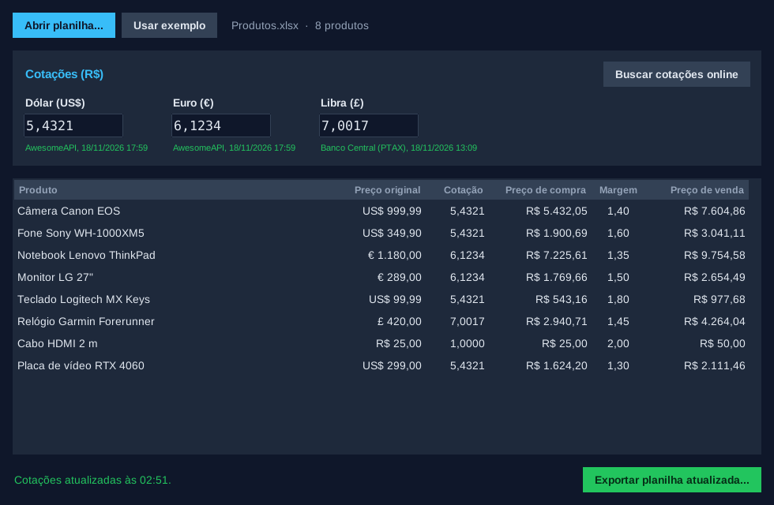

# Atualizador de Preços

Recalcula em reais os preços de produtos comprados em moeda estrangeira (dólar, euro, libra), usando a cotação do dia buscada na internet. Abre uma planilha Excel ou CSV, mostra o resultado numa tabela e exporta uma planilha nova já formatada.



## Funcionalidades

- **Abre planilhas** `.xlsx` ou `.csv`. No CSV, aceita separador `;` ou `,` e números no formato brasileiro (`1.234,56`).
- **Busca as cotações** do dólar, do euro e da libra com um clique, em duas fontes públicas e gratuitas:
  1. [AwesomeAPI](https://docs.awesomeapi.com.br/api-de-moedas) (principal);
  2. [PTAX do Banco Central](https://dadosabertos.bcb.gov.br/dataset/dolar-americano-usd-todos-os-boletins-diarios) (reserva, se a primeira falhar).
- **Funciona sem internet**: é só digitar a cotação nos campos. Embaixo de cada valor aparece a origem (fonte e horário, ou "valor digitado").
- **Recalcula na hora** quando uma cotação muda.
- **Exporta** uma planilha `.xlsx` com os preços formatados em R$ e uma segunda aba registrando as cotações usadas e de onde vieram.
- **Avisa a linha** de cada erro da planilha (preço inválido, moeda desconhecida, coluna faltando).
- **Planilha de exemplo** em `exemplo/Produtos.xlsx`, aberta pelo botão **Usar exemplo**.

## Formato da planilha

| Produto | Preço Original | Moeda | Margem |
|---|---|---|---|
| Câmera Canon EOS | 999,99 | Dólar | 1,4 |
| Notebook Lenovo ThinkPad | 1180,00 | Euro | 1,35 |
| Cabo HDMI 2 m | 25,00 | Real | 2 |

- **Moeda**: Dólar, Euro, Libra ou Real (também aceita USD, EUR, GBP, BRL, US$, €, £, R$).
- **Margem**: multiplicador sobre o custo (`1,5` = vender por 50% a mais) ou percentual (`50%`).
- Os nomes das colunas não diferenciam maiúsculas nem acentos, e podem estar em qualquer ordem. Outras colunas são ignoradas.

O cálculo:

```
Preço de Compra = Preço Original × Cotação
Preço de Venda  = Preço de Compra × Margem
```

## Requisitos

- Python 3.9 ou mais novo, com Tkinter (já vem no instalador oficial do Windows e do macOS).
  - No Ubuntu/Debian, se faltar: `sudo apt install python3-tk`
- [openpyxl](https://openpyxl.readthedocs.io/) para ler e gravar `.xlsx`.

## Como usar

```bash
git clone https://github.com/thi-araujo/web_automation_and_information_search.git
cd web_automation_and_information_search
pip install -r requirements.txt
python atualizador.py
```

No Linux/macOS, use `python3` e `pip3`.

## Estrutura do projeto

```
web_automation_and_information_search/
├── atualizador.py         # interface gráfica (Tkinter)
├── cotacoes.py            # busca das cotações (AwesomeAPI e Banco Central)
├── precos.py              # leitura da planilha, cálculo e exportação
├── exemplo/
│   └── Produtos.xlsx      # planilha de exemplo
├── tests/                 # testes automatizados
├── docs/                  # captura de tela usada neste README
└── requirements.txt
```

## Testes

Os testes de cotação usam respostas simuladas no formato das APIs, então rodam sem internet:

```bash
python -m unittest discover -s tests -v
```

## Histórico

Este projeto nasceu em 2022, num curso de automação, como um script que abria o Chrome com **Selenium**, pesquisava "cotação dólar" no Google, lia o valor da página por XPath e atualizava a tabela com **pandas** no Jupyter.

Em 2026 ele virou um aplicativo, e a busca da cotação passou a ser feita por APIs. Ler a página do Google quebra sempre que o layout muda (os XPaths originais não funcionam mais), exige Chrome e chromedriver instalados, é lento e vai contra os termos de uso do Google. Uma API devolve o valor direto, em formato estável, numa requisição de menos de um segundo.

## Autor

**Thiago Gomes Araújo**: [GitHub](https://github.com/thi-araujo) · [Portfólio](https://thi-araujo.github.io)
